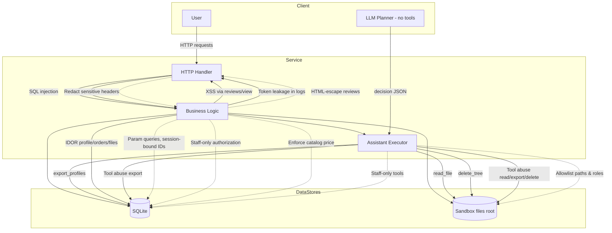
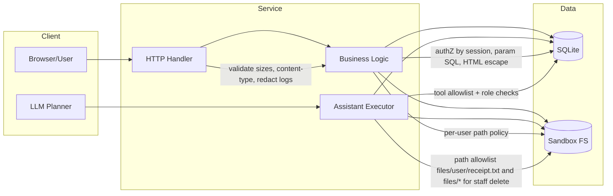

# Threat Model: Mini Shop

Scope: Local HTTP service, SQLite in-memory DB, temporary sandboxed files. Users: customers (alice, bob) and staff. AI assistant exposes context and tools.

Assets
- Customer PII in profiles
- Order data and receipts in sandbox files
- Staff-only data (export, logs, private/operator-note.txt)

Trust Boundaries
- HTTP request boundary (untrusted input)
- Auth session (X-Token -> server session map)
- Filesystem sandbox (sandbox.root)
- AI assistant boundary (model output -> executor)

Threats and Mitigations
- SQL injection via /profile, /search: Use parameterized queries; ignore client-provided IDs for own data
- IDOR on /profile, /orders, /files, /assistant/context: Bind to session identity; staff override; validate filenames
- Privilege escalation via X-Role header and assistant tools: Authorize by session role only; enforce per-tool checks
- Price tampering on /orders: Ignore client price; use catalog price
- XSS in /reviews/view: HTML-escape review text
- Sensitive data leakage via /debug/logs: Staff-only; redact X-Token
- Unsafe assistant execution: Constrain read_file to own receipt; restrict delete_tree to files/ for staff only; export_profiles staff-only
- Path traversal: sandbox.py enforces physical boundary; app enforces logical policy per user

Residual Risks
- Staff can still delete files/ tree (intended capability). Sandbox prevents escaping.
- Model prompt injection mitigated by executor restrictions; system prompt adds guidance but executor remains primary control.

Validation
- Unit tests and HTTP tests cover normal flows; added checks for access controls and escaping; run make test.

## Mermaid Diagram (System Context & Controls)

## Mermaid Diagram (Trust Boundaries)

